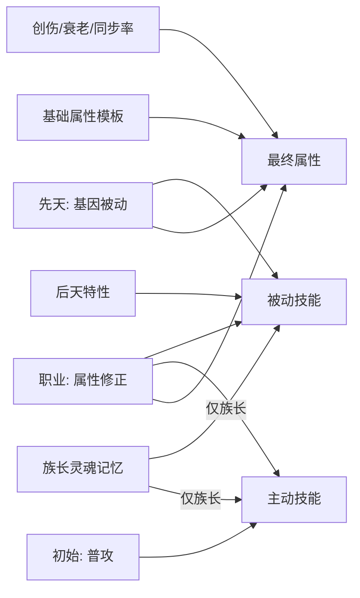

# 角色能力来源拆分（设计稿）

> 状态：已按第 9 节清单并入 [prototype.md](prototype.md) 与代码，待试玩验证。第 10 节仍待讨论。
> 所有数值均可调，初值以「与当前原型等价」为原则，避免拆分本身改变战斗手感。

## 1. 目的与服务的假设

当前原型里，一个角色的能力混在一起：L2/L3 点位直接写死体格与速度，L4 点位直接给主动技能，族长再叠加记忆。本稿把能力拆成边界清楚的几个来源，每个来源只负责一类东西。

| 假设 | 拆分后如何更容易被感受到 |
| --- | --- |
| H1 育种决定队友 | 基因决定「这个孩子适合做什么」，职业决定「他在场上做什么」。性格、基因被动和职业三者叠加后，行为差异更稳定、更好辨认 |
| H2 AI 造势、族长收割 | 职业把破甲手、推撞手、护卫、射手的分工固定下来，职业被动直接服务于「给族长留破绽窗口」 |
| H6 长线育种 | L4 不再直接给主动技能，而是给放大某类职业的被动，育种目标从「生出会冲撞的孩子」变成「生出最适合当冲锋者的孩子」 |

## 2. 能力来源总表



| 来源 | 提供 | 如何获得 | 是否遗传 | 绑定 |
| --- | --- | --- | --- | --- |
| 基础属性模板 | 七项基础属性 | 所有角色共用 | — | — |
| 先天：基因 | 基因被动（属性修正、机制效果、非战斗效果） | 出生时由基因型表达 | 是 | 肉体 |
| 初始 | 普攻 | 出生即有，不可移除 | — | — |
| 职业 | 属性修正、职业主动技能、职业被动 | 成年后转职 | 否 | 肉体 |
| 后天特性 | 后天被动 | 经历、应激（原型 4.7） | 否 | 个体，夺舍时可吸收 |
| 族长灵魂记忆 | 记忆主动技能、记忆被动 | 历练点、绝境觉醒、夺舍吸收（原型 4.6.4） | 否 | 灵魂，仅族长 |

### 2.1 来源硬约束

- **主动技能** = 普攻 + 当前职业的主动技能。基因和后天特性都**不提供**主动技能。
- **族长例外**：灵魂记忆可以额外装配主动战技与号令，照旧占用记忆槽。职业技能不占记忆槽。
- **被动技能**分属四个池子，池子之间**互不重合**（同一个被动不会同时出现在两个池子里）：

| 池子 | id 形式 | 对谁生效 |
| --- | --- | --- |
| 基因被动 | `gene.<等位基因 id>` | 所有人 |
| 职业被动 | `job.*` | 所有人 |
| 后天被动 | 无前缀，与记忆共用 id | 子嗣 |
| 记忆被动 | 无前缀 | 仅族长 |

- 后天特性在夺舍时原样转入记忆池，所以后天与记忆共用同一套 id；两者靠「在子嗣身上还是在族长灵魂里」区分，界面按此标注来源。

- 被动不重合，指的是被动本身不重复。不同池子的被动可以修正同一个数值（例如基因的「碎甲腺」和后天的「破势专家」都提高破甲值），这时按第 8 节的规则叠加。

## 3. 基础属性模板

所有角色共用：

| HP | ATK | DEF | ARM | SPD | MOV | EVA |
| --- | --- | --- | --- | --- | --- | --- |
| 100 | 20 | 10 | 30 | 100 | 3 | 5% |

该模板与原型中「均衡 + 常速」的体格完全一致，因此纯通用基因的角色拆分前后属性不变。族长的「真祖之力」（HP +20、ATK +5）不属于模板，视为灵魂加成，见第 8 节。

## 4. 先天：基因被动

### 4.1 规则

- 每个等位基因对应一个基因被动，被动名沿用等位基因名。
- 被动效果分三类：
  - **属性修正**：对基础属性加减固定值，或乘以百分比，例如 `SPD +20`、`ATK +10%`。
  - **机制效果**：改变战斗规则，例如受到的 Delay 减半、击退距离 +1。
  - **非战斗效果**：记忆槽数、性格、心理成长、衰老起始月。
- 显隐性、共显性、休眠规则不变（原型 4.4.1）。共显性时两个被动同时生效：数值类修正取平均，机制效果与标签类效果同时生效。
- 休眠的等位基因不提供被动。

### 4.2 L1–L6 映射表

**L1 灵魂承载**：只影响记忆槽，与原型一致。

| 等位基因 | 被动 id | 效果 |
| --- | --- | --- |
| 凡庸 | `gene.mundane` | 记忆槽 2 |
| 宽域 | `gene.wide` | 记忆槽 3 |
| 神经织网（精灵，出生休眠） | `gene.neuralWeb` | 记忆槽 4 |

**L2 骨骼肌理**：从「直接写死体格」改为「对模板的修正」。

| 等位基因 | 被动 id | HP | DEF | ARM | MOV | EVA | 修正后（与原型对照） |
| --- | --- | --- | --- | --- | --- | --- | --- |
| 均衡 | `gene.balanced` | — | — | — | — | — | 100 / 10 / 30 / 3 / 5%（一致） |
| 幽影之躯 | `gene.shadow` | −20 | −5 | −10 | +1 | +15% | 80 / 5 / 20 / 4 / 20%（一致） |
| 矮人重骨 | `gene.dwarfBone` | +30 | +8 | +20 | −1 | −5% | 130 / 18 / 50 / 2 / 0%（一致） |

**L3 体液神经**

| 等位基因 | 被动 id | 效果 | 修正后 SPD |
| --- | --- | --- | --- |
| 常速 | `gene.normalSpeed` | — | 100 |
| 迅捷 | `gene.swift` | SPD +20 | 120 |
| 沉稳（矮人） | `gene.steady` | SPD −15；受到的 Delay 减半 | 85 |
| 灵速（精灵） | `gene.elfSpeed` | SPD +35 | 135 |

**L4 器官特化**：**不再给主动技能**，改为放大某类职业打法的机制被动。

| 等位基因 | 被动 id | 效果 | 最契合的职业 |
| --- | --- | --- | --- |
| 獠牙 | `gene.fang` | 近战攻击造成伤害的 15% 转为自身回复 | 任意近战，偏攻击 |
| 冲撞肌 | `gene.ram` | 自身技能的击退距离 +1 | 冲锋者、破阵者 |
| 碎甲腺 | `gene.acid` | 自身攻击的破甲值 +40% | 蚀甲者 |
| 锻臂（矮人） | `gene.forgeArm` | DEF +5；自身被击退的距离 −1（最低 0） | 护卫、铁壁 |
| 光感（精灵） | `gene.lightSense` | 射线类技能射程 +1 | 猎手、影猎 |

> 原型中「冲撞肌 + 碎甲腺」共显性得到双天生技能，这一育种目标在新规则下变为双增幅：冲锋者的冲撞同时多推一格、破甲更高。是否同样有吸引力，列入第 10 节讨论。

**L5 心智倾向**：只提供非战斗效果与性格标签，数值部分改写为属性修正。

| 等位基因 | 被动 id | 效果 |
| --- | --- | --- |
| 迟钝 | `gene.docile` | 性格 = 迟钝；狂信增长 x0.7，疑心增长 x0.5 |
| 多疑 | `gene.paranoid` | 性格 = 多疑；狂信增长 x0.8，疑心增长 x1.5；ATK +10% |
| 狂信 | `gene.zealot` | 性格 = 狂信；狂信增长 x1.5，疑心增长 x0.8 |

**L6 端粒寿命**

| 等位基因 | 被动 id | 效果 |
| --- | --- | --- |
| 常寿 | `gene.normalLife` | 衰老起始 36 月 |
| 长寿 | `gene.longevity` | 衰老起始 48 月 |
| 燃命 | `gene.burn` | 衰老起始 24 月；ATK +20% |
| 永春（精灵，出生休眠） | `gene.evergreen` | 衰老起始 60 月 |

## 5. 初始状态

- 出生时没有职业，只有普攻（近战 1 格，倍率 1.0，破甲 10，冷却 0）和基因被动。
- 普攻是所有角色的保底技能，任何来源都不能移除它。
- 幼年不能出征，因此「无职业只有普攻」只会出现在刚成年、尚未转职的子嗣身上。

## 6. 职业

### 6.1 规则

- 每个角色同时只有一个职业，分**初阶**和**高阶**两档。
- 成年后可以在主城随时转职，暂不设条件，也不消耗资源。
- 转职后，旧职业的属性修正、主动技能、被动全部移除，换成新职业的。
- 初阶：1 个主动 + 1 个被动 + 小幅属性修正。
- 高阶：2 个主动 + 1 个被动 + 中幅属性修正。标注「建议前置」的初阶职业，目前只作展示，不强制。
- 职业技能的冷却规则与现有技能相同（按自身行动次数计）。

### 6.2 初阶职业

| 职业 | 属性修正 | 主动技能 | 职业被动 | AI 意图偏向 |
| --- | --- | --- | --- | --- |
| 冲锋者 | HP +10 | 冲撞：近战，倍率 0.8，破甲 10，击退 2，冷却 2 | `job.impactForce` 冲击力：自己造成的撞击失衡伤害由 10% 提高到 15% 最大生命 | 破势（推撞） |
| 蚀甲者 | ATK +2 | 腐蚀：近战，倍率 0.6，破甲 35，冷却 2 | `job.exposeWeakness` 剖开弱点：由自己的破甲使目标进入破绽时，目标额外 Delay 25% | 破势（破甲） |
| 护卫 | DEF +5，ARM +10 | 盾击：近战，倍率 0.9，破甲 20，击退 1，Delay 30%，冷却 2 | `job.guardPosture` 护卫姿态：触发反应拦截后进入防御状态，直到自身下次行动 | 护驾 |
| 猎手 | SPD +10 | 标记射击：射线射程 3，倍率 1.0，破甲 10，Delay 20%，冷却 2 | `job.spotter` 观测手：被自己 Delay 的目标在其下次行动前，受到族长的伤害 +20% | 攻击 / 破势（Delay） |

### 6.3 高阶职业

| 职业 | 建议前置 | 属性修正 | 主动技能 | 职业被动 | AI 意图偏向 |
| --- | --- | --- | --- | --- | --- |
| 破阵者 | 冲锋者 | HP +20，ATK +3 | 冲撞；**震地**（新）：以自身为中心的十字 1 格，倍率 0.5，破甲 10，击退 1，冷却 3 | `job.chainImpact` 连锁冲击：被自己击退的单位撞上其他敌人时，两者都进入破绽 | 破势 |
| 铁壁 | 护卫 | HP +20，DEF +8，ARM +20，SPD −10 | 盾击；**挑衅**（新）：3 格内一名敌人，其下次行动中攻击自己的候选 x2.0，冷却 3，纯功能技能 | `job.bulwark` 不动如山：受到伤害 −10% | 护驾 |
| 影猎 | 猎手 | SPD +15，EVA +5% | 标记射击；**穿影射击**（新）：射线射程 4，视线不受障碍阻挡，倍率 1.2，破甲 15，冷却 3 | `job.shadowAim` 影袭：背击伤害系数由 1.5 提高到 1.8 | 攻击 |

### 6.4 职业如何放大性格

职业不改变性格，只改变「这种性格在场上会做出什么事」：

- 狂信 + 护卫或铁壁：护驾、拦截、挑衅叠加，是最明显的「替你挡刀」。
- 多疑 + 猎手或影猎：远程输出与自保倾向一致，多疑不再只是缺点，而是一种可规划的配置。
- 迟钝 + 冲锋者或蚀甲者：严格跟随态势指令，是最可靠的破绽制造者。
- 反配置会制造张力，例如多疑 + 护卫：职业要求贴近族长，性格却倾向后撤，玩家能直接看到「这个孩子不适合这份工作」。

## 7. 族长与夺舍

- **职业属于肉体**：夺舍后沿用容器原有的职业，族长之后可以在主城转职。
- 族长的主动技能 = 普攻 + 职业主动 + 已装配的记忆主动。职业技能不占记忆槽。
- 灵魂记忆、记忆池、记忆槽规则不变（原型 4.6.4），夺舍的「丰收」来源不变。
- 后天特性规则不变（原型 4.7.5）：子嗣的后天特性留在个人身上，夺舍时战斗类、经营类原样转入记忆池，id 不变。
- 基因被动随肉体：夺舍换肉体后，族长获得新肉体的基因被动，失去旧肉体的。

## 8. 属性计算顺序

```text
1. 基础模板
2. + 基因被动的固定值修正（共显性时取平均）
3. + 职业的固定值修正
4. + 族长灵魂加成（HP +20、ATK +5，仅族长）
5. x (1 + 所有百分比修正之和)        // 基因、职业、后天、记忆的百分比修正先相加，再一次相乘
6. 创伤与磨损修正
7. 衰老修正
8. x 族长同步率系数（仅族长，作用于 HP / ATK / DEF）
9. 战斗中的条件被动（如濒死血怒、惜命者），在战斗内实时计算
```

- 下限保护不变：HP >= 10，ATK >= 1，DEF >= 0，ARM >= 5，SPD >= 40，MOV >= 1，EVA 限制在 0~60%。
- 同一数值上的多个机制修正（如破甲值 +40% 与 +30%）按加法合并：破甲 x (1 + 0.4 + 0.3)。
- 与原型的差异：多疑、燃命的 ATK 百分比原本先于族长加成相乘，现在在第 5 步统一相乘，族长 ATK 会有 1~2 点误差，可接受。

## 9. 并入原型时的改动清单（已执行）

实现时的取舍：撕咬退役；族长开局无职业；艾德里安开局冲锋者，薇拉开局蚀甲者；震地按「相邻 4 格全体敌人」实现。

### 9.1 数值等价性核对

| 项目 | 结果 |
| --- | --- |
| L2 三种体格 | 模板 + 修正与原型数值完全一致（见 4.2） |
| L3 四种速度 | 完全一致；沉稳的 Delay 减半保留 |
| L5 / L6 | 效果一致，仅 ATK 百分比的相乘时机变化（见第 8 节） |
| L4 | **不等价**：原天生技能移入职业；撕咬没有对应职业，退役或留作敌人技能 |
| 天生技能表（原型 5.3） | 冲撞、腐蚀、盾击、标记射击原数值不变，改由职业提供 |

开局家族（原型 5.2）拆分后：

| 角色 | 原主动技能 | 建议开局职业 | 新主动技能 | 新增基因被动 | 属性变化 |
| --- | --- | --- | --- | --- | --- |
| 族长 | 撕咬 + 血刃横扫 + 穿刺突进 | 无职业 | 普攻 + 血刃横扫 + 穿刺突进（记忆） | 獠牙吸血 | 无 |
| 艾德里安 | 冲撞 | 冲锋者 | 普攻 + 冲撞 | 冲撞肌：击退 +1，冲撞变为击退 3 格 | HP +10 |
| 薇拉 | 腐蚀 | 蚀甲者 | 普攻 + 腐蚀 | 碎甲腺：破甲 +40%，腐蚀变为 49 | ATK +2 |
| 卢卡（幼年） | 撕咬 / 腐蚀（共显性） | 无（未成年） | 普攻 | 獠牙吸血 + 碎甲腺破甲增幅 | 无 |

艾德里安「推撞」与薇拉「破甲」的第一场行为对比保留，而且因基因增幅变得更明显（服务 H1）。族长失去撕咬，这会降低开局输出，需要试玩确认；备选方案是让族长开局为冲锋者。

### 9.2 原型文档

- 4.1：派生属性表的「来源」列改为「基础模板 + 基因被动 + 职业」；天生技能一行改为职业。
- 4.4.2：L2、L3 表改为修正值，L4 表改为基因被动。
- 新增「4.x 职业」章节，即本稿第 6 节。
- 5.2：开局家族增加职业列。
- 5.3：天生技能表改为职业技能表，并加入三个新技能。
- 2.1：纳入表增加「职业」一行；1.2 不变。

### 9.3 代码

- [web/src/config/alleles.ts](../web/src/config/alleles.ts)：`AlleleDef` 的数值字段改为被动修正，L4 去掉 `skill`，改为机制被动。
- 新增 `web/src/config/classes.ts`：职业定义（档位、属性修正、主动技能 id、被动 id、建议前置）。
- [web/src/config/skills.ts](../web/src/config/skills.ts)：新增震地、挑衅、穿影射击；撕咬按 9.1 处理。
- [web/src/core/character.ts](../web/src/core/character.ts)：`deriveStats` 按第 8 节重写，主动技能 = 普攻 + 职业技能，被动列表合并四个池子。
- `web/src/core/types.ts`：`Character` 增加 `classId: string | null`。
- 战斗引擎与 AI：实现各职业被动与基因机制被动（吸血、击退加距、破甲增幅、拦截后防御、观测手、连锁冲击、挑衅、背击系数）；AI 候选已基于 `unit.skills`，职业技能可以直接接入。
- 主城：家族成员页增加转职入口，并显示每个被动的来源标签（基因 / 职业 / 后天 / 记忆）。
- 存档：旧存档的 `classId` 补为 `null`，开局家族按 9.1 设定职业。
- 测试：[web/tests/sim.test.ts](../web/tests/sim.test.ts) 的自动出征需要给成年子嗣分配默认职业，否则 AI 只有普攻。

### 9.4 风险

- 没有职业的成年子嗣只有普攻，性格差异会被技能单一掩盖。缓解：成年时弹出转职提示，或按 L4 表达自动推荐一个职业。
- 随时免费转职会让职业失去「这个孩子是什么人」的身份感。原型期先放开，以便测试，再视试玩反馈加限制。

## 10. 待讨论

- 高阶职业的前置条件：用经历计数（如制造破绽 10 次解锁破阵者），还是资源消耗（金币、诱变原液）。
- 转职是否消耗月份、金币，或带来疑心变化（例如被强制转为护卫的多疑子嗣疑心上升）。
- L4 改为被动后，「双增幅」作为共显性育种目标的吸引力是否足够（H6）。
- 族长开局是否需要职业（见 9.1）。
- 撕咬是退役、作为敌人技能，还是成为某个新初阶职业（如「掠食者」）的技能。
