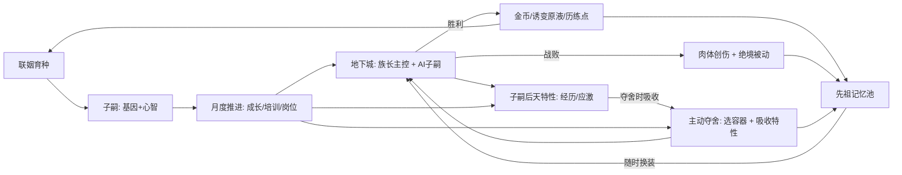
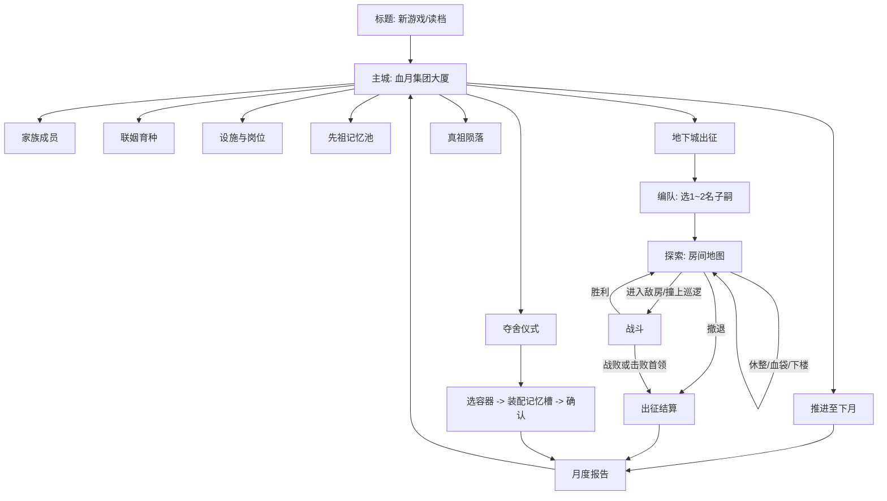
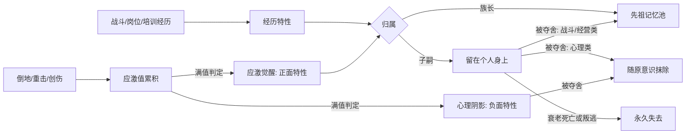
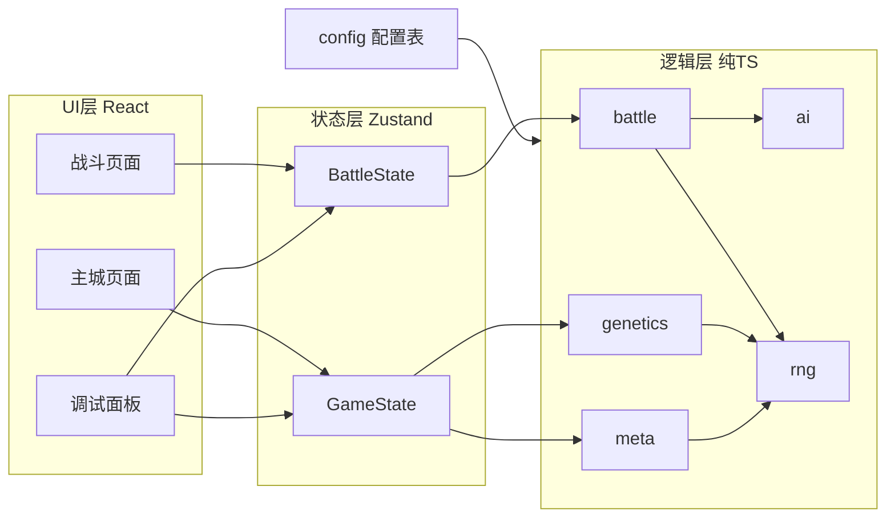

# 《真祖信托》Web 原型需求文档（Prototype PRD）

> 版本：v0.1　｜　来源：[draft.md](draft.md)　｜　形态：单机 Web 沙盒原型（可无限推进）
>
> 本文档只描述原型阶段要做的内容。所有数值均为初始值，标注“可调”，以配置表形式外置，方便试玩后迭代。

---

## 1. 原型目标与验证假设

### 1.1 草案核心体验提炼

草案系统众多，但真正区别于普通战棋/经营游戏的，是三条因果链的串联：

1. **育种决定队友性格**：染色体点位（尤其心智点位）+ 狂信/疑心 -> Utility AI 权重 -> 战场上子嗣“替你挡刀”或“临阵自保”。玩家不直接操作队友，只能通过“生什么样的孩子、怎么培养”来间接影响战局。
2. **只控族长 + 机会主义收割**：AI 子嗣负责破甲、推撞、卡位，制造破绽；玩家抓住破绽窗口用族长处决。
3. **灵肉双轨**：肉体（硬件）可折旧、会衰老、终将被抛弃；灵魂（软件）经验永久累积。战败不是惩罚而是沉淀，夺舍是一次期待已久的“丰收”。

狂信度 / 疑心度是连接局外养成和局内表现的心理纽带，也是黑色幽默叙事的主要载体。

原型的唯一目标：**用最低成本让这三条因果链首尾相接地跑起来，并判断它们是否好玩。**

### 1.2 验证假设与观察指标

| 编号 | 假设 | 可观察指标 |
| --- | --- | --- |
| H1 | 育种结果能在战斗中被玩家“看出来” | 试玩者不看属性面板，仅凭战斗表现能说出某子嗣是狂信型还是多疑型，识别率 >= 70% |
| H2 | 只控族长 + 收割破绽有配合爽感 | 每场战斗平均出现 >= 2 次由 AI 子嗣制造、被玩家处决的破绽；试玩者主观评价“有配合感” |
| H3 | 战败可接受且有沉淀感 | 战败后试玩者选择继续游玩而非重开的比例 >= 80%；能说出战败带来了什么收益 |
| H4 | 夺舍是被期待的“丰收” | 试玩者在肉体自然死亡前主动夺舍；选择容器时出现明显权衡（基因 vs 狂信 vs 剩余寿命 vs 该子嗣积累的后天特性） |
| H5 | 狂信/疑心带来张力 | 试玩者会为压制疑心主动付出资源或调整岗位；疑心暴雷时有明显情绪反应 |
| H6 | 存在长线育种规划 | 试玩者会为某个目标基因组合做两代及以上的配种规划 |

### 1.3 非目标

- 最终美术、音效、动画表现（全部使用色块、图标、文字占位）
- 最终数值平衡与内容量（只需足以支撑约 2~3 代传承的体验）
- 剧情主线与终局目标（沙盒无限推进，仅以“真祖陨落”作为失败结局）

---

## 2. 原型范围裁剪

### 2.1 纳入并做实

| 系统 | 原型内容 | 理由 |
| --- | --- | --- |
| 格点战场 | 8x8 网格、障碍格、物理阻挡、4 向面向与背击 | 卡位/护驾必须依赖物理阻挡才能被看见 |
| 动态行动条（CTB） | 速度驱动顺位、行动轴预览、Delay 效果 | 草案核心战斗特征，与破绽窗口强相关 |
| 族长主控 | 手动移动、普攻、记忆槽技能、处决 | 玩家唯一直接操作对象 |
| AI 子嗣 | 1~2 名随行，Utility AI 完全自驱 | 验证 H1、H2 的核心 |
| 破绽与处决 | 破甲 或 撞墙/撞人失衡 -> 破绽 -> 族长处决 | 验证“AI 造势、玩家收割” |
| 战术态势 | 收拢护卫 / 协同合围 / 各自保全，随时切换 | 玩家对 AI 的唯一宏观干预手段 |
| 性格涌现 | 狂信护驾（含反应拦截）、多疑自保、迟钝顺从 | 验证 H1 |
| 遗传系统 | 6 对染色体点位、等位基因显隐性、点位互斥、休眠性状；每个等位基因对应一个基因被动 | 育种是性格与能力的来源 |
| 职业 | 初阶 4 种、高阶 3 种；提供属性修正、职业主动技能与职业被动；成年后随时免费转职 | 主动技能只来自职业，分工清楚，AI 造势更易辨认（H1、H2）；详见 [character-build.md](character-build.md) |
| 心理双轨 | 狂信度、疑心度，影响 AI、夺舍同步率、告密/叛逃 | 验证 H5，连接局内外 |
| 主动夺舍 | 选容器、同步率、记忆槽装配、吸收容器的后天特性、旧肉体处理 | 验证 H4 |
| 战败沉淀 | 血遁撤退、肉体创伤、经验保留、绝境被动觉醒 | 验证 H3 |
| 后天特性 | 所有家族角色“做什么就变成什么”：经历特性 + 创伤-应激-觉醒/阴影；不随配种遗传，只能通过夺舍吸收传承 | 让每个子嗣成为独一无二的个体，并给夺舍增加“收割经验”的维度（H4） |
| 月度推进 | 财务、生理（年龄/孕期/成年/衰老）、心理波动、事件 | 局外节奏骨架 |

### 2.2 简化处理

| 系统 | 草案设定 | 原型简化 | 理由 |
| --- | --- | --- | --- |
| 联姻对象 | 四大异族 + C/B/A/S 四档 | 劳务派遣所（人类，C）+ 矮人辛迪加（C）+ 精灵资本（B） | 两个异族足以体现“异族基因红利”和点位互斥 |
| 家族阶层 | C -> B -> A -> S，经济 + 牌照双门槛 | 只做 C -> B 一次晋升 | 验证晋升门槛的设计即可 |
| 夺舍技术迭代 | 初阶 / 中阶 / 高阶三种 | 只做初阶“密室暴毙传位”，中高阶在 UI 中以“未研发”占位 | 一种足以验证夺舍的代价与收益 |
| 生产线 | 多种开环/闭环设施 | 开环 2 个（血浆站、矿山）+ 闭环 1 个（基因诱变室） | 保留“避战发育”与“战斗原料驱动质变”两种节奏 |
| 地下城 | 多区域、多阶段 | 单一地下城，4 层房间制探索（每层 3x3 槽位、5~7 间房，守卫房必打、支路可绕开），第 4 层为首领；可重复挑战，B 级解锁难度 II | 足以支撑反复验证，并让出征途中的损耗可规划 |
| 面向判定 | 正/侧/背击 | 只做背击加成 | 降低理解与开发成本 |
| 掩体 | 掩体遮挡 + 物理阻挡 | 障碍格 = 不可通行 + 阻挡远程射线 | 一种格子承担两种作用 |
| 时间尺度 | 现实化月份 | “血族催熟技术”：孕期 2 月、6 月成年、约 3 年衰老 | 沙盒中几十个回合即可体验换代 |
| 育种配对 | 未定义 | 家族成年成员 x 外部联姻对象，不区分性别，孕育过程抽象化 | 规避配对规则复杂度 |

### 2.3 本阶段不做

- ESG 信用评级、A/S 阶层、越级联姻的维护费崩溃与法务清算
- 集团敲钟上市终局、监管大军审计倒计时
- 圣堂教团、兽化人部族及其专属设施（功德忏悔室、内部角斗场）
- 老祖英灵体系（英灵附体、英灵共鸣）
- 子嗣退役提纯为基底血清、合成母本的高阶基因配方
- 芯片义体改装、黑账洗白等其他闭环设施
- 美术资源、音效、多语言

---

## 3. 核心循环与界面流程

### 3.1 核心循环



- **短循环（单月）**：安排岗位、培训、配种、调整记忆装配 -> 出征或直接推进月份 -> 看月报。
- **中循环（数月）**：等待子嗣出生成年 -> 带新子嗣出征 -> 积累历练点解锁记忆，子嗣在战斗与岗位中积累后天特性。
- **长循环（一代，约 20~30 月）**：族长肉体创伤累积/衰老 -> 挑选最佳容器（基因、同步率、后天特性综合权衡）-> 夺舍换代 -> 新肉体 + 吸收的传承记忆再出发。

### 3.2 界面结构



### 3.3 各界面要点

**主城（血月集团大厦）**
- 顶栏常驻：当前月份、金币、诱变原液、历练点、家族阶层、族长肉体状态（年龄 / 距衰老月数 / 创伤数）。
- 左侧导航进入各功能页；右下角固定【推进至下月】按钮，按下前若有未分配岗位的成年成员给出提示。
- 族长肉体进入衰老期后，顶栏状态变红并提示“请尽快安排继任仪式”。

**家族成员**
- 卡片列表：姓名、年龄阶段、表型标签（如【狂信】【幽影之躯】【冲撞肌】）、狂信/疑心/应激三条、当前岗位、创伤、后天特性图标。
- 详情页：完整基因型（6 对点位，显示等位基因与显隐、休眠标记）、派生战斗属性、职业（成年可转职）与职业技能、带来源标签的被动（基因 / 职业）、后天特性（含正在累积中的经历进度，如“拦截 2/3”）、父母信息。
- 操作：企业文化培训、疗养、心理疏导、安排岗位。

**联姻育种**
- 选择家族方（成年、未在孕育冷却中的成员，包括族长当前肉体）。
- 选择联姻方（按来源分页：劳务派遣所 / 矮人辛迪加 / 精灵资本），显示对方基因型与合同费。
- 选定后显示**子代表型概率预览**（逐点位列出各表型概率），确认后进入孕期。

**设施与岗位**
- 每个设施显示岗位上限、在岗成员、月产出、岗位疑心影响；拖拽或下拉分配。
- 基因诱变室显示可执行的诱变工单与工期。

**先祖记忆池**
- 展示所有记忆（武器战技 / 战术号令 / 被动 / 绝境被动 / 传承记忆 / 敌情解析）：已解锁、可用历练点解锁、未满足条件三种状态。
- 记忆装配：在主城（非出征途中）可随时免费调整族长当前肉体的装配；战斗与经营类记忆共用记忆槽，数量受当前肉体实际激活槽数限制。提供“出征配置 / 上岗配置”两套预设，一键切换。

**夺舍仪式**
- 候选容器对比表：基础属性、记忆槽数、职业与职业技能、同步率、剩余寿命、创伤，以及**夺舍后将被吸收的后天特性**（心理类特性标注“将被抹除”）。
- 选定容器后进入记忆装配界面，确认后播放文字演出并结算后果。

**战斗界面**
- 中央 8x8 网格；顶部或右侧为行动轴（显示未来 10 个行动顺位）。
- 底部：族长技能栏、处决按钮（有可处决目标时高亮）、待机/防御、三个态势按钮。
- 单位头顶：血条、护甲条、破绽标记、AI 意图气泡（如“护驾！”“我先撤了”）。
- 右侧：战斗日志（含 AI 决策原因的简短描述），调试模式下展开 AI 打分面板。

---

## 4. 系统需求

### 4.1 角色数据模型

角色数据严格按“肉体 / 灵魂 / 心理”三部分组织。灵魂只有族长拥有，且独立于任何一具肉体存在。

**肉体（Body，绑定在角色身上）**

| 字段 | 说明 |
| --- | --- |
| `id` / `name` / `generation` | 标识、姓名、第几代 |
| `race` | 人类 / 矮人 / 精灵 / 混血（由基因来源推导，仅用于显示） |
| `ageMonths` | 年龄（月）；阶段：幼年 0~5，成年 >= 6，衰老 >= 寿命点位决定的起始月 |
| `genome` | 6 个点位，每点位 2 个等位基因，每个等位基因带 `dormant` 休眠标记 |
| `traumas` | 创伤列表（见 4.7） |
| `parents` | 父母 id（家族方 + 联姻方） |
| `job` | 当前岗位，幼年不可上岗；族长也可以上岗 |
| `classId` | 当前职业（见 4.9），幼年为空；属于肉体，夺舍后沿用 |
| `breedCooldown` | 孕育冷却剩余月数 |

**派生战斗属性（基础模板 + 基因被动修正 + 职业修正，再叠加创伤、衰老与同步率；计算顺序见 [character-build.md](character-build.md) 第 8 节）**

基础模板：HP 100 / ATK 20 / DEF 10 / ARM 30 / SPD 100 / MOV 3 / EVA 5%。

| 属性 | 含义 | 主要修正来源 |
| --- | --- | --- |
| HP | 生命上限 | 骨骼肌理点位、职业 |
| ATK | 攻击力 | 寿命点位、心智点位（百分比）、职业 |
| DEF | 防御，伤害减算 | 骨骼肌理点位、锻臂、职业 |
| ARM | 护甲值（韧性条），归零进入破绽 | 骨骼肌理点位、职业 |
| SPD | 速度，决定行动频率 | 体液神经点位、职业 |
| MOV | 移动力（格） | 骨骼肌理点位 |
| EVA | 闪避率 | 骨骼肌理点位、职业 |
| 记忆槽 | 成为族长容器后可装配的记忆数（所有类型共用） | 灵魂承载点位 |
| 主动技能 | 普攻 + 职业主动技能；族长另加已装配的记忆主动 | 职业 |
| 被动技能 | 基因被动 + 职业被动 + 后天特性（子嗣）或记忆被动（族长），四个来源互不重合 | 基因、职业、后天、灵魂 |
| 性格 | 迟钝 / 狂信 / 多疑 | 心智点位 |

**心理（Psyche，仅家族子嗣拥有）**

| 字段 | 范围 | 说明 |
| --- | --- | --- |
| `devotion` 狂信度 | 0~100 | 夺舍同步率主要来源；战场护驾意愿 |
| `suspicion` 疑心度 | 0~100 | 战斗消极、同步率惩罚、告密与叛逃 |
| `stress` 应激值 | 0~100 | 创伤与惊险经历的累积，满值触发应激判定（见 4.7.3） |

**后天（Acquired，绑定个体，不随配种遗传）**

| 字段 | 说明 |
| --- | --- |
| `experience` | 经历计数器：拦截次数、制造破绽次数、击杀数、各岗位在岗月数、培训次数等 |
| `acquiredTraits` | 已获得的后天特性：正面特性（经历特性、应激觉醒）与阴影特性（应激失败） |

族长同样记录 `experience`，但族长获得的后天特性直接写入灵魂的先祖记忆池；子嗣的后天特性留在个人身上，直到被族长夺舍时吸收（见 4.7.5）。

**灵魂（Soul，全局唯一，属于真祖）**

| 字段 | 说明 |
| --- | --- |
| `soulXP` 历练点 | 用于在先祖记忆池中解锁记忆，跨代永久保留 |
| `memoryPool` | 已解锁的记忆列表 |
| `equipped` | 当前肉体已装配的记忆（任意类型混装，数量 <= 当前肉体实际激活记忆槽数） |
| `intel` | 各敌人类型击杀计数，达到阈值解锁“敌情解析”被动 |
| `stats` | 累计战斗/战败/夺舍次数等，用于绝境被动解锁条件与数据埋点 |
| `generationCount` | 已完成夺舍次数 |

族长 = 当前肉体 + 灵魂。族长肉体不计算心理指标，性格点位对族长本人无效（但会遗传给后代）。族长可以和子嗣一样上岗工作，占用岗位名额、正常产出，不产生岗位疑心，并累积岗位经历。

### 4.2 战斗系统

#### 4.2.1 战场

- 8x8 网格。格子类型：地面、障碍。障碍不可通行，并阻挡远程攻击射线（按格中心连线经过的格子判定）。
- 每层战斗从预设的 6~8 套布局模板中随机一套，敌人从遭遇池中按层数随机生成。
- 我方出生区为下方两行，敌方出生区为上方两行。

#### 4.2.2 动态行动条（CTB）

- 每个单位维护 `nextActAt`（下次行动时刻）。开战时 `nextActAt = 1000 / SPD × 随机(0.8~1.0)`。
- 总是由 `nextActAt` 最小的单位行动；行动结束后 `nextActAt += 1000 / SPD × 行动消耗系数`。
  - 移动 + 行动：系数 1.0；仅移动或仅待机：系数 0.7；防御：系数 0.8。
- **Delay（推迟）**：技能可使目标 `nextActAt += 1000 / 目标SPD × Delay百分比`。
- 行动轴 UI 显示未来 10 个顺位；族长回合选择技能时，预览该技能 Delay 后的新顺位。

#### 4.2.3 回合内操作

每个单位的回合由“可选移动 + 可选行动”组成，顺序为先移动后行动；行动后不能再移动。

| 操作 | 说明 |
| --- | --- |
| 移动 | 4 向寻路，步数 <= MOV。可以穿过己方单位，但不能停在任何单位所在格；不能穿过敌方单位（物理阻挡），不能穿过障碍 |
| 普攻 | 近战相邻 1 格（或按技能射程），倍率 1.0，破甲 10 |
| 技能 | 族长：记忆槽中的主动记忆 + 职业技能；子嗣：职业技能 |
| 处决 | 族长专属、常驻，不占记忆槽。目标必须处于破绽且与族长相邻 |
| 防御 | DEF +50% 直到下次行动，行动消耗系数 0.8 |
| 待机 | 什么也不做，行动消耗系数 0.7 |

**面向**：单位面向自身最后一次移动或攻击的方向。从目标背后（目标面向的反方向那一格）攻击，伤害 x1.5。

#### 4.2.4 伤害公式

```
伤害 = max(1, ATK × 技能倍率 − 目标DEF)
       × 背击系数(1.5 或 1.0)
       × 敌情解析系数(1.15 或 1.0)
       × 其他被动系数
       × 随机(0.9 ~ 1.1)
命中判定：命中率 = 1 − 目标EVA（处决必中）
护甲伤害：目标 ARM −= 技能破甲值（与伤害同时结算，被闪避则不结算）
```

#### 4.2.5 破绽与处决

- **破绽来源**
  1. 破甲：目标 ARM 降到 0。
  2. 失衡：目标被击退时撞上障碍、地图边缘或其他单位。撞击时被击退者与被撞单位各受 10% 最大生命值伤害。
- **失衡清空进度**：陷入破绽时，目标已累积的行动进度清零，`nextActAt = max(原值, 当前时刻 + 1000 / 目标SPD)`。族长通常能在它恢复前赶到；族长比目标慢时仍可能被反超，因此族长的速度有额外价值。
- **破绽持续**：直到该单位的下一次行动开始（Delay 仍可进一步延长窗口）。破绽期间 DEF 减半。
- **破绽结束**：ARM 恢复至上限。
- **处决**：倍率 2.5，无视 DEF，必中。默认需与目标相邻；装配记忆【血影闪现】后，可对 4 格内的破绽目标发动，族长闪现到其身旁再处决（视为本回合已移动）。处决击杀时，族长 `nextActAt` 回退 50% 本次行动消耗。
- **处决震慑**：每次处决后，全体队友的 `nextActAt` 提前其行动间隔的 25%（不早于当前时刻），让收割直接带动队伍节奏。
- 敌方单位同样可以对我方破绽单位造成额外伤害（敌人无处决技，仅享受 DEF 减半）。

#### 4.2.6 击退

- 击退方向 = 攻击者指向目标的方向；斜向不出现（只有 4 向）。
- 逐格推进，遇到阻挡即停止并判定撞击失衡。

#### 4.2.7 反应拦截（护驾）

- 触发时机：敌方对族长发动攻击，结算前。
- 候选者：与族长相邻、未处于破绽、未在本轮已拦截过的我方子嗣。
- 触发概率：`狂信度 / 100 × 性格系数`（狂信 1.0、迟钝 0.3、多疑 0.05），疑心 >= 60 时再乘 0.5。
- 效果：拦截者与族长互换位置并代为承受此次攻击（伤害 x0.8）；弹出气泡“为了家族！”。
- 每名子嗣每次自身行动之间最多拦截 1 次。

#### 4.2.8 战术态势

- 三种态势：【收拢护卫】【协同合围】【各自保全】。默认【协同合围】。
- 族长回合中可随时免费切换，立即影响之后所有 AI 子嗣的打分（见 4.3）。

#### 4.2.9 胜负与倒地

- **胜利**：敌方全灭。
- **战败**：族长 HP 归零，触发血遁，本次出征结束（见 4.7）。
- **子嗣倒地**：HP 归零时退出本场战斗，出征结算时获得 1 个随机创伤与应激（见 4.7.3），不会死亡；同队其他子嗣疑心 +5、应激 +15。倒地子嗣本次出征不再归队，除非族长装配【血契唤醒】（见 4.2.10）。
- 战斗之间不自动回复；回复来源见 4.2.10。

#### 4.2.10 地下城结构与探索

地下城“旧城区地下血库遗址”共 4 层，每层是一张房间地图：

- **房间布置**：每层在 3x3 的房间槽位里随机生成 5~7 间相连的房间。主路为 入口 → 空房 → 守卫房 → 下层楼梯；第 4 层主路为 入口 → 空房 → 审判庭（首领房）。另有挂在守卫房之前的支路：1 个休整点、1~2 间支路敌群（第 4 层 1 间）。地图是树形，守卫房是下楼的唯一通道，支路都是可绕开的死胡同。
- **地图与移动**：进入一层即可看到全部房间、房间之间的通路及其中内容（敌群构成、休整点、楼梯、巡逻队当前位置），到过的房间以实线框区分。点击相连房间前进，每走一次算 1 步。每间房有固定障碍布局，在此开战即使用该布局，我方总从下边进门。
- **战斗触发**：
  - 进入有敌人的房间立即开战。守卫房敌群沿用原各层遭遇（第 1 层 3~4 敌、第 2 层 4~5 敌、第 3 层 5 敌、首领 + 2 随从）；支路敌群 2~3 人。
  - 每层 1 支巡逻队（2 人），起点在空房或休整点，每走 `patrolEvery`（2）步移动到一间相邻的无敌人房间，不进入守卫房、首领房与楼梯。巡逻队进入你所在的房间，或你走进巡逻队所在的房间，都算**被伏击**：我方初始行动进度推迟一个行动间隔，敌方先动。
  - **先手**：族长装配记忆【夜行先机】时，进入有固定敌群的房间，敌人初始行动进度推迟一个行动间隔，我方先动。
- **战利品**：守卫房按层给金币与诱变原液并计入“通过层数”；支路敌群打赢后开宝箱（额外金币，按层 20%~80% 概率得 1 份原液）；巡逻队只给击杀历练点。击败首领即通关。
- **战斗之间的回复与补救**：
  - **下楼**：站着的成员恢复 20% 最大生命（`floorHeal`）。
  - **休整点（血库残罐）**：每层 1 个，一次性，站着的成员各恢复 35% 最大生命。
  - **血袋**：血浆站有人在岗时，出征编队页可购买（每袋 30 金，每次最多 3 袋）。探索中对单人使用，恢复 40% 最大生命，不能救起倒地者。
  - **血契唤醒**（记忆被动，历练点 60）：战斗胜利后，倒地子嗣以 30% 生命归队；倒地带来的创伤与应激照旧在出征结算时处理（同一出征多次倒地只结算一次）。
- **撤退**：不在战斗中时随时可撤退，保留全部战利品。
- 每次出征（无论胜败、是否中途撤退）消耗当月时间：返回主城后自动执行月度结算。
- 难度 II（B 级解锁）：敌人 HP/ATK x1.4，掉落 x1.6。
- 以上数值均可在调试模式「数值配置 → 地下城探索」中调整。

### 4.3 AI 决策：效用系统（Utility AI）

#### 4.3.1 决策流程

1. 生成候选：对当前单位所有可达格（含原地）x 所有可用行动（普攻/技能/防御/待机）x 所有合法目标，生成候选动作。8x8 地图下候选数在数百以内，可全量枚举。
2. 为每个候选打上一个**意图（Intent）**标签，并计算得分。
3. 选择得分最高的候选执行（配置项：可切换为“前 3 名按分数加权随机”，用于观察多样性）。
4. 记录前 5 名候选及其各因子明细，供日志、气泡和调试面板使用。

#### 4.3.2 打分公式

```
得分 = 基础权重 × 战况适宜度 × 性格修正 × 态势修正 × 心理修正
```

#### 4.3.3 意图与战况适宜度

| 意图 | 基础权重 | 战况适宜度（0~2，示意） |
| --- | --- | --- |
| 攻击 Attack | 1.0 | 预计伤害 / 目标当前 HP（可击杀时 x1.5）；目标处于破绽 x1.3 |
| 破势 Break | 1.0 | 目标 ARM 剩余比例越低越高；能造成撞击失衡 x1.8；目标距族长 <= 2 格 x1.3（为族长造势）；附带 Delay 且目标即将行动 x1.2 |
| 护驾 Guard | 0.8 | 移动到“族长与最近威胁之间”或与族长相邻的格子；值 = 族长威胁度 × (1.5 − 族长HP%) |
| 后撤 Retreat | 0.6 | 移动到受威胁最低的格子；值 = (1 − 自身HP%)² × 自身威胁度 × 2；身处首领 AoE 预警范围内额外 +0.8 |
| 集结 Regroup | 0.4 | 与族长距离 > 3 时生效，距离越远越高 |
| 防御 Defend | 0.3 | 本回合无法攻击且处于威胁范围时生效 |

- **威胁度**：下一轮能攻击到该格的敌人数量与其 ATK 的加权和，归一化到 0~1。
- 一个候选可同时满足多个意图（如“移动到族长身前并攻击敌人”），取其中最高的意图分，再加上其他意图分的 30%。

#### 4.3.4 性格修正

| 性格（心智点位表型） | 攻击 | 破势 | 护驾 | 后撤 | 集结 | 特殊规则 |
| --- | --- | --- | --- | --- | --- | --- |
| 狂信 | 1.0 | 1.0 | 2.0 | 0.3 | 1.3 | 反应拦截性格系数 1.0 |
| 多疑 | 1.1 | 0.9 | 0.5 | 2.0（HP < 50% 或在 AoE 内时 3.0） | 0.7 | 反应拦截性格系数 0.05 |
| 迟钝 | 1.0 | 1.0 | 1.0 | 1.0 | 1.0 | 态势修正效果放大（态势系数取 1.5 次方） |

#### 4.3.5 态势修正

| 态势 | 攻击 | 破势 | 护驾 | 后撤 | 集结 |
| --- | --- | --- | --- | --- | --- |
| 收拢护卫 | 0.8 | 0.9 | 1.8 | 1.0 | 1.5 |
| 协同合围 | 1.2 | 1.6 | 0.7 | 0.8 | 1.0 |
| 各自保全 | 1.0 | 1.0 | 0.5 | 1.6 | 0.6 |

#### 4.3.6 心理修正

- 护驾意图额外乘 `0.5 + 狂信度 / 100`。
- 疑心 >= 60：所有“高风险候选”（护驾、移动到 >= 2 名敌人相邻的格子）乘 `1 − (疑心 − 60) / 50`。
- 疑心 >= 80：每回合 10% 概率“消极怠工”，直接执行待机，气泡“……这真的值得吗？”。
- 战术号令（族长记忆，见 4.6.4）作为一次性修正乘入，持续到该子嗣下一次行动结束。
- 后天特性（见 4.7）中影响意图的部分（如“惊弓之鸟”“首领恐惧”）作为额外乘子乘入，并在调试面板中单独列出。

#### 4.3.7 气泡与日志

- 每次 AI 行动按“最高意图 + 性格”从文案表中抽一句气泡，例如：
  - 狂信 + 护驾：“父亲大人，请退后！”
  - 多疑 + 后撤：“我可不想死在这种地方。”
  - 迟钝 + 攻击：“收到指令。”
- 战斗日志记录简短原因，例如：`薇拉 后撤至(3,6)：HP 35%，多疑 x3.0，各自保全 x1.6`。
- 气泡属于正式体验的一部分（直接服务 H1），不是调试功能。

#### 4.3.8 敌人 AI

- 敌人复用同一套打分框架，只是使用不同的性格修正表：
  - 猎手型：攻击族长的候选额外 x1.3（制造护驾情境）。
  - 野兽型：优先攻击 HP 比例最低的目标。
  - 重盾型：破势 x1.5，偏好把目标推向障碍。
- 首领拥有脚本化技能（见 5.4），技能释放时机由打分决定，预警范围对玩家可见。

### 4.4 遗传系统

#### 4.4.1 规则

- 每个角色 6 个点位，每点位 2 个等位基因。
- **遗传**：子代每个点位从家族方、联姻方各随机继承 1 个等位基因（各 50%）。
- **显隐性**：每个等位基因有显性等级（数字越大越显性）。表达等级最高者；等级相同且不同的两个等位基因**共显性**：数值效果取平均，标签/技能类效果同时表达。
- **点位互斥**：同一点位只能表达一个（或共显性的一对）性状，天然实现草案中的“幽影之躯与矮人重骨互斥”。
- **休眠性状**：部分异族高阶等位基因出生时处于休眠状态。休眠的等位基因在表达计算中视为不存在（由同点位另一个等位基因单独表达），但仍会遗传（遗传给子代时依旧是休眠）。需在基因诱变室消耗诱变原液激活。
- 原型中基因型对玩家**完全可见**（含联姻对象），以便验证规划乐趣（见 9 章讨论）。

#### 4.4.2 点位与等位基因表（可调）

**L1 灵魂承载（记忆槽）**

| 等位基因 | 来源 | 显性等级 | 效果 |
| --- | --- | --- | --- |
| 凡庸 | 通用 | 2 | 记忆槽 2 |
| 宽域 | 通用 | 1 | 记忆槽 3 |
| 神经织网 | 精灵 | 3，出生休眠 | 记忆槽 4 |

每个表达的等位基因都提供一个同名基因被动。共显性时数值修正取平均，机制效果同时生效。

**L2 骨骼肌理（体格，对基础模板的修正）**

| 等位基因 | 来源 | 显性等级 | HP | DEF | ARM | MOV | EVA | 修正后 |
| --- | --- | --- | --- | --- | --- | --- | --- | --- |
| 均衡 | 通用 | 2 | — | — | — | — | — | 100 / 10 / 30 / 3 / 5% |
| 幽影之躯 | 通用 | 1 | −20 | −5 | −10 | +1 | +15% | 80 / 5 / 20 / 4 / 20% |
| 矮人重骨 | 矮人 | 3 | +30 | +8 | +20 | −1 | −5% | 130 / 18 / 50 / 2 / 0% |

**L3 体液神经（速度）**

| 等位基因 | 来源 | 显性等级 | 效果 |
| --- | --- | --- | --- |
| 常速 | 通用 | 2 | — （SPD 100） |
| 迅捷 | 通用 | 1 | SPD +20 |
| 沉稳 | 矮人 | 2 | SPD −15，受到的 Delay 减半 |
| 灵速 | 精灵 | 1 | SPD +35 |

**L4 器官特化（机制被动，不再提供主动技能）**

| 等位基因 | 来源 | 显性等级 | 基因被动 | 最契合的职业 |
| --- | --- | --- | --- | --- |
| 獠牙 | 通用 | 2 | 近战攻击伤害的 15% 转为自身回复 | 任意近战 |
| 冲撞肌 | 通用 | 1 | 自身技能的击退距离 +1 | 冲锋者、破阵者 |
| 碎甲腺 | 通用 | 1 | 自身攻击的破甲值 +40% | 蚀甲者 |
| 锻臂 | 矮人 | 3 | DEF +5；自身被击退的距离 −1 | 护卫、铁壁 |
| 光感 | 精灵 | 2 | 射线类技能射程 +1 | 猎手、影猎 |

> 共显性时两个增幅同时生效（如“冲撞肌 + 碎甲腺”的冲锋者既多推一格、破甲又更高），这是育种的高价值目标之一。

**L5 心智倾向（性格）**

| 等位基因 | 来源 | 显性等级 | 表型 | 心理成长修正 | 其他 |
| --- | --- | --- | --- | --- | --- |
| 迟钝 | 通用 | 3 | 迟钝 | 狂信增长 x0.7，疑心增长 x0.5 | 后勤岗位理想人选 |
| 多疑 | 通用 | 2 | 多疑 | 狂信增长 x0.8，疑心增长 x1.5 | ATK +10% |
| 狂信 | 通用 | 1 | 狂信 | 狂信增长 x1.5，疑心增长 x0.8 | — |

> 狂信为最隐性，需双亲都携带才可能出现，与“迟钝最稳定、狂信最难得”的设定吻合。

**L6 端粒寿命（衰老）**

| 等位基因 | 来源 | 显性等级 | 衰老起始月 | 其他 |
| --- | --- | --- | --- | --- |
| 常寿 | 通用 | 2 | 36 | — |
| 长寿 | 通用 | 1 | 48 | — |
| 燃命 | 通用 | 1 | 24 | ATK +20% |
| 永春 | 精灵 | 1，出生休眠 | 60 | — |

#### 4.4.3 联姻来源

| 来源 | 阶层要求 | 候选数 / 刷新 | 合同费 | 基因池 | 首次联姻家族红利 |
| --- | --- | --- | --- | --- | --- |
| 劳务派遣所 | C | 4 名 / 每 3 月 | 200 | 仅通用等位基因，随机 | — |
| 矮人辛迪加 | C | 2 名 / 每 3 月 | 600 | 至少 1 个矮人等位基因 | 【债务质押】告密事件罚金 −50% |
| 精灵资本 | B | 2 名 / 每 3 月 | 1500 | 至少 1 个精灵等位基因 | 【工时监控算法】全族月度疑心 −1 |

- 联姻方为合同制，配种后离开，不加入家族。
- 家族方必须成年、未孕育冷却；配种后进入 2 个月孕期，家族方冷却 3 个月。
- 子代出生时：年龄 0，狂信 30，疑心 0，自动命名（可改名）。

#### 4.4.4 子代概率预览

- 选定配对后，逐点位显示子代各表型的概率（基于 2x2 组合直接计算），并标出休眠等位基因的继承概率。
- 例：家族方 L5 = 迟钝/狂信，联姻方 L5 = 多疑/狂信 -> 迟钝 50%、多疑 25%、狂信 25%。

### 4.5 心理系统

#### 4.5.1 狂信度变化

| 来源 | 变化 | 备注 |
| --- | --- | --- |
| 企业文化培训 | +8 × 性格狂信系数 | 每人每月 1 次，50 金 |
| 随族长出征且胜利 | +3 × 性格狂信系数 | 每次出征结算 |
| 疑心 >= 60 | 每月 −2 | 怀疑侵蚀信仰 |
| 幼年期 | 仅可通过培训提升 | 幼年不能上岗、不能出征，是低疑心期培养狂信的窗口 |

#### 4.5.2 疑心度变化

| 来源 | 变化 | 备注 |
| --- | --- | --- |
| 成年后自然增长 | 每月 +1 | 年纪越大越会察觉 |
| 月度随机波动 | 每月 −2 ~ +3 | |
| 岗位：血浆站出纳 | 每月 +3 | 天天经手血袋 |
| 岗位：矿山 | 每月 +1 | |
| 同队子嗣倒地 | +5 | |
| 夺舍（密室暴毙传位） | 全族 +20 | |
| 家族公益晚宴 | 全族 −10 | 每月最多 1 次，300 金 |
| 关怀谈话（随机事件选项） | −10 | |
| 精灵红利【工时监控算法】 | 全族每月 −1 | |

所有“增长”类变化乘以性格疑心系数。

#### 4.5.3 阈值效果

| 疑心 | 效果 |
| --- | --- |
| >= 40 | 夺舍同步率开始受惩罚 |
| >= 60 | 战斗中高风险候选降权；拦截概率减半；狂信每月 −2 |
| >= 80 | 战斗中 10%/回合消极怠工；每月 15% 概率触发**告密事件**：罚金 500，全族疑心 +5 |
| 100 | 月末**叛逃**：该成员离开家族（带走其全部基因），月报中以讽刺文案报道 |

### 4.6 夺舍系统

#### 4.6.1 触发条件

- 在主城“夺舍仪式”页面主动发起，不在出征途中。
- 容器：成年、未倒地重伤、同步率 >= 20 的家族子嗣。
- 费用：500 金（“葬礼与公关费”），消耗当月时间（确认后立即进行月度结算）。

#### 4.6.2 同步率

```
同步率 = clamp(狂信度 − max(0, 疑心度 − 40), 0, 100)
实际激活记忆槽 = max(1, floor(容器记忆槽 × (0.5 + 同步率 / 200)))
属性继承系数   = 0.85 + 0.15 × 同步率 / 100     （作用于新肉体 HP/ATK/DEF）
```

例：容器记忆槽 3、同步率 100 -> 激活 3 槽，属性 x1.0；同步率 50 -> 激活 2 槽，属性 x0.925。

#### 4.6.3 流程

1. 候选对比：展示每个候选的派生属性、职业与职业技能、记忆槽、同步率、实际激活槽数、距衰老月数、将被吸收与将被抹除的后天特性。
2. 记忆装配：从先祖记忆池中选择不超过实际激活槽数的记忆装配到新肉体（之后在主城也可随时调整）。
3. 确认演出：文字演出“董事长于私人会客室突发心疾，享年 X 月。新任董事长 XX 宣誓就职。”
4. 结算：
   - 旧肉体死亡，从家族移除，其创伤随之消失。
   - 新肉体成为族长：保留其基因型（基因被动）、职业、年龄、创伤（创伤属于肉体）；心理指标与应激值不再计算。
   - **吸收后天特性**：容器的战斗类、经营类正面后天特性转化为“传承记忆”写入先祖记忆池；心理类特性与阴影特性随原意识一同被抹除（见 4.7.5）。
   - 全族疑心 +20（乘各自性格系数）。
   - 灵魂 `generationCount + 1`。
- 中阶“全息双簧”、高阶“数字血脉”在 UI 中显示为灰色“未研发”。

#### 4.6.4 先祖记忆池

记忆是族长的“软件”成长，跨代永久保留，记忆池本身不设上限。新解锁的记忆**立即可用**：在主城（非出征途中）可随时免费调整装配。

**槽位统一原则**：所有角色都用有限的槽位装配所有类型的能力，战斗类与经营类共用同一组槽位。
- 族长：记忆槽数量由当前肉体的灵魂承载点位决定，从先祖记忆池中任选装配。经营类记忆效果与子嗣持有时相同、作用于族长本人（如“血账老手”需族长本人在血浆站上岗才生效）。
- 子嗣：没有记忆池，持有的后天特性即装配中的特性，上限 4 个（见 4.7.4）。
- 经营类效果按月度结算时族长的装配状态判定。出征会自动触发当月结算，因此“带战技出征”与“装经营记忆上岗”在同一个月内互斥，族长前期需要在两者之间取舍；家族壮大、有专职工人后，族长可以专注战斗配置，这个取舍会自然消失。

因此夺舍的“丰收”感来自以下几方面，而不是解锁记忆本身：
- 更好的肉体：更多记忆槽、更强的基因属性、清零的衰老与旧创伤。
- 吸收容器的后天特性：子嗣一生积累的经验只有通过夺舍才能被家族保留。
- 槽位压力释放：记忆池越来越大，而旧肉体的槽位有限，换一具大容量肉体才能把攒下的记忆真正用起来。

| 类别 | 获取方式 | 示例 |
| --- | --- | --- |
| 武器战技 | 历练点解锁 | 血刃横扫、穿刺突进、血之锁链、夜幕步 |
| 战术号令 | 历练点解锁 | 号令·集火、号令·死守 |
| 被动 | 历练点解锁 | 处决精通、血族体质、夜行先机、血契唤醒 |
| 绝境被动 | 族长战败时满足条件自动觉醒（见 4.7.2） | 濒死血怒、创伤抗性、断尾求生 |
| 族长经历特性 | 族长自身经历达到阈值（见 4.7.4），按战斗/经营归类 | 处刑人（战斗）、血账老手（经营） |
| 传承记忆 | 夺舍时吸收容器的战斗/经营类正面后天特性（见 4.7.5） | 舍身之盾、破势专家（战斗）；矿工体魄（经营） |
| 敌情解析 | 同类敌人累计击杀 10 次自动解锁，**常驻生效不占槽** | 对该类敌人伤害 +15% |

历练点来源：击杀 +5，通关一层 +10，击败首领 +50，战败时已获得的历练点全部保留。

### 4.7 战败、创伤、应激与后天特性

核心原则：**角色做过什么，就会变成什么。** 所有家族角色（族长与子嗣）都会因经历获得后天特性。后天特性属于“软件”，绑定个体、不随配种遗传；唯一的传承途径是被族长夺舍时吸收进先祖记忆池。



#### 4.7.1 族长战败结算

- 族长 HP 归零 -> 血遁秘术 -> 本次出征结束，返回主城并进行月度结算。
- 本次出征获得的金币、诱变原液损失 50%；历练点、击杀计数、经历计数全部保留。
- 族长肉体获得 1 个随机创伤（最多叠加 3 个，满 3 个后改为 HP 上限额外 −5%）。
- 检查绝境被动觉醒条件（见 4.7.2 末表）。

#### 4.7.2 创伤

| 创伤 | 效果 |
| --- | --- |
| 筋骨断裂 | HP 上限 −10% |
| 神经灼伤 | SPD −8 |
| 内脏破损 | DEF −3 |
| 血脉紊乱 | ARM −10 |

- 来源：族长战败、子嗣倒地，各获得 1 个随机创伤。
- 创伤属于肉体：族长夺舍后随旧肉体抛弃；被夺舍的容器自带的创伤会保留到新族长身上。
- 疗养：400 金移除 1 个创伤（族长与子嗣通用），同时应激 −20。

**族长绝境被动**（族长版的“应激觉醒”：真祖意志不会产生阴影，满足条件直接写入先祖记忆池）

| 绝境被动 | 觉醒条件 | 效果 |
| --- | --- | --- |
| 濒死血怒 | 首次战败 | HP < 30% 时 ATK +30% |
| 创伤抗性 | 身负 >= 2 个创伤时战败 | HP < 50% 时受到伤害 −15% |
| 断尾求生 | 战败时所有随行子嗣均已倒地 | HP < 25% 时 MOV +2 |
| 血债血偿 | 在首领层战败 | 处决伤害 +25% |

#### 4.7.3 子嗣应激（创伤 - 应激 - 特性线）

**应激来源**

| 来源 | 应激 |
| --- | --- |
| 自身倒地 | +40 |
| 同队子嗣倒地 | +15 |
| 单次受到 >= 30% 最大生命的伤害 | +10 |
| 被首领 AoE 命中 | +10 |
| 反应拦截替族长受创 | +5（狂信性格 x0.5） |
| 获得创伤 | +10 |

**应激消退**：每月 −10；疗养 −20；家族公益晚宴全族 −5。

**应激判定**：出征结算时，应激 >= 100 的子嗣进行一次判定，结果为“觉醒”或“阴影”，之后应激重置为 30。

```
觉醒概率 = 30% + 狂信度 × 0.4% − 身负创伤数 × 5%   （多疑性格额外 −10%，结果限制在 10%~80%）
```

具体特性按本次应激的主要来源从对应池中抽取（如因倒地累积 -> 濒死类；因首领 AoE 累积 -> 首领类）。

| 应激觉醒（正面） | 来源倾向 | 效果 |
| --- | --- | --- |
| 濒死血怒 | 倒地 | HP < 30% 时 ATK +30% |
| 劫后余生 | 倒地 | 每场战斗首次 HP 归零时以 1 HP 存活 |
| 创伤抗性 | 创伤/重击 | HP < 50% 时受到伤害 −15% |
| 直面审判 | 首领 AoE | 对首领伤害 +15%，首领在场时后撤意图不再获得 AoE 加成 |

| 心理阴影（负面） | 来源倾向 | 效果 |
| --- | --- | --- |
| 首领恐惧 | 首领 AoE | 首领在场时后撤 x1.5，ATK −10% |
| 血光惊悸 | 同队倒地 | 战斗中每有队友倒地，额外疑心 +5 |
| 惊弓之鸟 | 重击 | 受到攻击后，下次行动的后撤意图 x2.0 |
| 怀疑一切 | 任意 | 疑心增长 x1.3 |

- 心理疏导：300 金移除 1 个阴影，但该成员疑心 +5（“这次谈话让他想到了更多”）。
- 阴影在被夺舍时随原意识一同被抹除，不会进入先祖记忆池。

#### 4.7.4 经历特性

每个角色持续记录经历计数，达到阈值自动获得对应特性（每种只获得一次）。

| 特性 | 类别 | 获得条件 | 效果（个人持有时） |
| --- | --- | --- | --- |
| 舍身之盾 | 战斗 | 反应拦截累计 3 次 | 拦截时伤害倍率 0.8 -> 0.5 |
| 破势专家 | 战斗 | 制造破绽（破甲或失衡）累计 10 次 | 破甲值 +30% |
| 惜命者 | 战斗 | 后撤后到下次行动前未受伤，累计 5 次 | HP < 50% 时 EVA +15% |
| 嗜血 | 战斗 | 击杀累计 15 次 | 击杀后回复 10% 最大生命 |
| 处刑人 | 战斗 | 处决累计 20 次（实际只有族长能达成） | 处决伤害 +20% |
| 血账老手 | 经营 | 血浆站在岗累计 12 月 | 本人在血浆站产出 +30% |
| 矿工体魄 | 经营 | 矿山在岗累计 12 月 | HP 上限 +10% |
| 企业文化标兵 | 心理 | 接受培训累计 10 次 | 狂信增长 x1.2 |
| 见惯风浪 | 心理 | 作为旁观者经历夺舍 2 次 | 夺舍带来的疑心增长 −50% |

- 子嗣没有自己的特性池：持有即生效，战斗、经营、心理类正面后天特性（经历特性 + 应激觉醒）共用 4 个特性位，满额时获得新特性需选择替换，被替换的特性永久失去；阴影不占特性位。
- 族长的先祖记忆池不设上限，可无限积累；同时生效的数量只受当前肉体记忆槽限制（所有类型共用）。
- 心理类特性只作用于子嗣自身的狂信/疑心，族长没有心理指标，因此族长不会获得心理类特性，夺舍时也不会吸收。
- 应激觉醒特性全部归为战斗类。
- 经历特性会自然地强化性格：狂信子嗣更容易拦截从而获得“舍身之盾”，多疑子嗣更容易后撤从而获得“惜命者”。

#### 4.7.5 后天特性的归属与传承

- **不随配种遗传**：基因是可遗传的硬件，后天特性是不可遗传的软件。子嗣出生时没有任何后天特性。
- **族长**：族长获得的经历特性（战斗/经营）与绝境被动直接写入先祖记忆池。
- **子嗣**：后天特性留在个人身上，作用于其本人的战斗、经营与心理表现。
- **夺舍吸收**：族长夺舍某子嗣时，该子嗣的正面后天特性按类别处理：
  - 战斗类：转为传承记忆，装入记忆槽后作用于族长本人。
  - 经营类：转为传承记忆，与战斗记忆共用记忆槽，效果与子嗣持有时相同，作用于族长本人（族长需在对应设施上岗才能触发岗位类效果）。
  - 心理类：不吸收，随原意识一同被抹除（夺舍对象的“企业文化标兵”等特性在夺舍那一刻变得毫无意义，月报配讽刺文案）。
- **永久失去**：未被夺舍的子嗣衰老死亡或叛逃时，其后天特性永久失去，月报提示“XX 的毕生经验随其一同埋葬”。这制造了“要不要趁早夺舍他”的压力。

### 4.8 月度经营

#### 4.8.1 月内可执行操作

无行动点限制，仅受金币与“每人每月一次”约束：安排岗位、企业文化培训、联姻配种、基因诱变工单、疗养、心理疏导、家族公益晚宴、调整族长记忆装配（免费、不限次数）、出征（执行后自动结算本月）、夺舍（执行后自动结算本月）、推进至下月。

#### 4.8.2 月度结算顺序

1. **财务**：设施产出 − 大厦维护费 − 成员生活费。
2. **生产工期**：基因诱变工单推进并完成。
3. **生理演化**：全员年龄 +1；孕期推进与出生；幼年满 6 月成年；衰老效果累加；自然死亡判定。
4. **心理波动**：岗位、自然增长、随机波动、红利效果；应激自然消退；岗位/培训经历计数推进并检查经历特性获得。
5. **社会事件**：告密判定、叛逃判定、联姻候选刷新、随机事件（每月 40% 概率触发 1 个）。
6. **月度报告**：弹窗汇总以上所有变化，配黑色幽默文案。

#### 4.8.3 设施

| 设施 | 类型 | 岗位上限 | 每名在岗成员月产出 | 岗位疑心 |
| --- | --- | --- | --- | --- |
| 基础血浆站（出纳） | 开环 | 3 | +100 金 | +3 / 月 |
| 矿山 | 开环 | 3 | +70 金 | +1 / 月 |
| 基因诱变室 | 闭环 | — | 见下 | — |

- 大厦维护费 100 金 / 月；成员生活费 20 金 / 人 / 月（含幼年）。
- 出征的成员当月仍计算岗位产出（简化处理）。
- 族长可上岗：占用 1 个岗位名额、正常产出、不产生岗位疑心、累积岗位经历（获得的经营特性直接写入先祖记忆池）。

**基因诱变室工单（工期 1 个月，同时只能进行 1 个）**

| 工单 | 消耗 | 效果 |
| --- | --- | --- |
| 激活休眠性状 | 诱变原液 x3 + 200 金 | 将指定成员的 1 个休眠等位基因激活 |
| 定向诱变 | 诱变原液 x2 + 100 金 | 将指定成员指定点位的 1 个等位基因随机替换为该点位的另一个通用等位基因 |

> 诱变原液只能从地下城获得，资金无法单向转化为基因质变，促使玩家适时出征。

#### 4.8.4 衰老与自然死亡

- 到达衰老起始月后，每月 SPD −2、HP 上限 −2%。
- 衰老起始 + 18 月：自然死亡。
- **族长肉体自然死亡且未完成夺舍 = 真祖陨落（游戏结束）**，显示本局统计并允许重开。
- 子嗣自然死亡从家族移除，其后天特性永久失去。

#### 4.8.5 家族阶层晋升（C -> B）

- 条件：现金 >= 3000，且首次击败地下城首领（获得“特许经营牌照”）。
- 晋升费用：2000 金。
- 效果：解锁精灵资本联姻、地下城难度 II。

#### 4.8.6 随机事件（示例，可扩充）

| 事件 | 内容 | 选项 |
| --- | --- | --- |
| 记者暗访 | 《夜枭日报》记者在血浆站附近徘徊 | 支付 200 金“广告合作费” / 拒绝：全族疑心 +5 |
| 慈善颁奖 | 集团获评“年度最具人文关怀企业” | 获得 300 金政府补贴 |
| 日记风波 | 发现某成年子嗣的日记里写着“父亲从不吃晚饭” | 关怀谈话（50 金，该成员疑心 −10） / 无视：该成员疑心 +15 |
| 工会请愿 | 矿山员工要求“带薪休息” | 同意：本月矿山产出 −50%，全族疑心 −3 / 驳回：矿山在岗成员疑心 +5 |

### 4.9 职业

- 每个角色同时只有一个职业，分初阶与高阶。成年后在家族成员页随时免费转职，暂无前置条件；高阶的「建议前置」只作展示。
- 转职后旧职业的属性修正、主动技能与被动全部替换。没有职业的角色只有普攻。
- 职业属于肉体：夺舍后沿用容器的职业，族长的职业技能不占记忆槽。

| 职业 | 档位 | 属性修正 | 主动技能 | 职业被动 |
| --- | --- | --- | --- | --- |
| 冲锋者 | 初阶 | HP +10 | 冲撞 | 冲击力：自己造成的撞击失衡伤害由 10% 提高到 15% 最大生命 |
| 蚀甲者 | 初阶 | ATK +2 | 腐蚀 | 剖开弱点：由自己破甲使目标进入破绽时，目标额外 Delay 25% |
| 护卫 | 初阶 | DEF +5，ARM +10 | 盾击 | 护卫姿态：触发反应拦截后进入防御状态 |
| 猎手 | 初阶 | SPD +10 | 标记射击 | 观测手：被自己 Delay 的目标在其下次行动前受到族长伤害 +20% |
| 破阵者 | 高阶（建议前置冲锋者） | HP +20，ATK +3 | 冲撞、震地 | 连锁冲击：被自己击退撞上其他单位时，被击退者也进入破绽 |
| 铁壁 | 高阶（建议前置护卫） | HP +20，DEF +8，ARM +20，SPD −10 | 盾击、挑衅 | 不动如山：受到伤害 −10% |
| 影猎 | 高阶（建议前置猎手） | SPD +15，EVA +5% | 标记射击、穿影射击 | 影袭：背击伤害系数由 1.5 提高到 1.8 |

---

## 5. 初始数值表（全部可调）

### 5.1 开局状态

- 月份：第 1 月；家族阶层：C；金币 1500；诱变原液 0；历练点 0。
- 月度收支预估：收入 170（矿山 70 + 血浆站 100），支出 180（维护 100 + 4 人生活费 80），**每月小幅亏损**，需要出征补贴、培养更多劳动力，或让族长亲自上岗（“董事长深入基层”）。
- 族长灵魂加成：族长肉体在派生属性基础上额外 HP +20、ATK +5（“真祖之力”）。

### 5.2 开局家族

| 角色 | 年龄 | L1 灵魂承载 | L2 骨骼肌理 | L3 体液神经 | L4 器官特化 | L5 心智 | L6 端粒 | 狂信 / 疑心 | 岗位 | 职业 |
| --- | --- | --- | --- | --- | --- | --- | --- | --- | --- | --- |
| 族长（第 1 代肉体） | 20 | 宽域/宽域 | 均衡/幽影之躯 | 常速/迅捷 | 獠牙/冲撞肌 | 迟钝/狂信 | 常寿/长寿 | — | 空闲（可安排） | 无 |
| 长子 艾德里安 | 10 | 宽域/宽域 | 均衡/均衡 | 常速/常速 | 冲撞肌/冲撞肌 | 狂信/狂信 | 常寿/燃命 | 60 / 10 | 矿山 | 冲锋者 |
| 次女 薇拉 | 8 | 凡庸/宽域 | 幽影之躯/幽影之躯 | 迅捷/迅捷 | 碎甲腺/碎甲腺 | 多疑/狂信 | 长寿/常寿 | 35 / 30 | 血浆站 | 蚀甲者 |
| 幼子 卢卡 | 2 | 凡庸/宽域 | 均衡/幽影之躯 | 常速/迅捷 | 獠牙/碎甲腺 | 迟钝/多疑 | 常寿/常寿 | 30 / 0 | — | —（幼年） |

开局后天状态：

| 角色 | 后天特性 | 经历进度 | 应激 |
| --- | --- | --- | --- |
| 艾德里安 | 舍身之盾 | 矿山在岗 4/12 月 | 20 |
| 薇拉 | 惜命者 | 血浆站在岗 2/12 月，制造破绽 6/10 | 35 |
| 卢卡 | — | 培训 3/10 | 0 |

设计意图：
- 艾德里安（狂信、冲撞）与薇拉（多疑、腐蚀）在第一场战斗就形成鲜明的行为对比，直接服务 H1；两人开局自带的后天特性进一步放大这种对比。
- 艾德里安拥有 3 记忆槽、狂信度高，还持有“舍身之盾”，是最佳容器，但他同时也是最好的护卫——“夺舍他（并吸收舍身之盾）还是留着他”是第一次夺舍的核心纠结（H4）。
- 薇拉“制造破绽 6/10”离“破势专家”很近，让试玩者早期就能看到经历特性的获得过程。
- 族长携带隐性“狂信”，并为纯合“宽域”（记忆槽 3），与合适的联姻对象配种可产出狂信/宽域后代，为长线规划埋点（H6）。
- 族长第 1 代肉体在第 17 月进入衰老，第 35 月自然死亡，提供软性的换代压力。

开局记忆池：已解锁并装配【血刃横扫】【穿刺突进】【血影闪现】（族长肉体为“宽域”，记忆槽 3，开局已满）。新解锁的记忆可随时在主城替换装配；族长若想上岗并获得经营特性加成，需要临时让出一个战技槽位。

### 5.3 技能表

**族长记忆（先祖记忆池）**

| 记忆 | 类别 | 解锁（历练点） | 范围 | 倍率 | 破甲 | 冷却 | 效果 |
| --- | --- | --- | --- | --- | --- | --- | --- |
| 血刃横扫 | 武器战技 | 初始 | 前方及左右共 3 格 | 0.8 | 15 | 1 | — |
| 穿刺突进 | 武器战技 | 初始 | 直线前冲至多 2 格后攻击前方 1 格 | 1.3 | 10 | 2 | 前冲可绕到背后 |
| 血之锁链 | 武器战技 | 40 | 直线射程 3 | 0.6 | 10 | 2 | 将目标拉到族长相邻格，Delay 25%（可拉撞其他单位造成失衡） |
| 夜幕步 | 武器战技 | 40 | 3 格内空地 | — | — | 3 | 瞬移，下一次攻击伤害 +30%，视为移动，之后仍可行动 |
| 号令·集火 | 战术号令 | 60 | 任一敌人 | — | — | 3 | 全体子嗣下次行动对该目标的攻击/破势候选 x2.0 |
| 号令·死守 | 战术号令 | 60 | 全体子嗣 | — | — | 3 | 子嗣下次受到伤害 −30%，护驾候选 x1.5 |
| 血影闪现 | 被动 | 初始 | 4 格内破绽目标 | — | — | — | 处决前闪现到目标身旁 |
| 夜行先机 | 被动 | 40 | — | — | — | — | 进入敌群尚未察觉的房间时我方先动（见 4.2.10） |
| 血契唤醒 | 被动 | 60 | — | — | — | — | 战斗胜利后倒地子嗣以 30% 生命归队，倒地创伤照旧（见 4.2.10） |
| 处决精通 | 被动 | 80 | — | — | — | — | 处决伤害 +30% |
| 血族体质 | 被动 | 80 | — | — | — | — | 每次行动开始时回复 3% 最大生命 |

处决：族长常驻能力，相邻破绽目标，倍率 2.5，无视 DEF，必中，冷却 0。

**职业技能（由职业提供，子嗣与族长肉体通用，见 4.9）**

| 技能 | 职业 | 范围 | 倍率 | 破甲 | 冷却 | 效果 |
| --- | --- | --- | --- | --- | --- | --- |
| 冲撞 | 冲锋者、破阵者 | 近战 1 | 0.8 | 10 | 2 | 击退 2 格 |
| 腐蚀 | 蚀甲者 | 近战 1 | 0.6 | 35 | 2 | — |
| 盾击 | 护卫、铁壁 | 近战 1 | 0.9 | 20 | 2 | 击退 1 格，Delay 30% |
| 标记射击 | 猎手、影猎 | 射线射程 3 | 1.0 | 10 | 2 | Delay 20% |
| 震地 | 破阵者 | 相邻 4 格全体敌人 | 0.5 | 10 | 3 | 击退 1 格 |
| 挑衅 | 铁壁 | 3 格内一名敌人 | — | — | 3 | 目标下次行动攻击自己的倾向 x2.0 |
| 穿影射击 | 影猎 | 射线射程 4，无视障碍 | 1.2 | 15 | 3 | — |

普攻（所有角色保底）：近战 1 格，倍率 1.0，破甲 10，冷却 0。原“撕咬”已退役。

冷却单位为“该单位自身的行动次数”。

### 5.4 敌人表（难度 I）

| 敌人 | 类型（AI） | HP | ATK | DEF | ARM | SPD | MOV | 攻击 |
| --- | --- | --- | --- | --- | --- | --- | --- | --- |
| 腐化鼠群 | 野兽型 | 40 | 12 | 2 | 10 | 130 | 4 | 近战 1 |
| 猎魔人学徒 | 猎手型 | 90 | 20 | 8 | 30 | 100 | 3 | 近战 1 |
| 银弹射手 | 猎手型 | 60 | 22 | 4 | 20 | 95 | 3 | 射线射程 4 |
| 圣铁重盾兵 | 重盾型 | 150 | 18 | 16 | 60 | 75 | 2 | 近战 1，盾击（击退 1） |
| 首领：审判官·格雷 | 猎手型 | 400 | 28 | 14 | 100 | 105 | 3 | 见下 |

**审判官·格雷技能**（为验证 H1 而设计的“性格试金石”）

| 技能 | 效果 | 设计目的 |
| --- | --- | --- |
| 银焰十字 | 第一次行动时标出以自身为中心的十字 2 格范围预警，下次行动时对范围内所有单位造成 1.5 倍伤害 | 制造 AoE 情境：多疑子嗣会提前逃离，狂信子嗣可能为了留在族长身边而硬吃 |
| 处刑宣告 | 标记族长，下次行动时对族长发动 2.5 倍重击（预警可见） | 制造护驾情境：狂信子嗣卡位/拦截的高光时刻 |
| 普通斩击 | 近战 1，倍率 1.0 | — |

### 5.5 遭遇池与掉落

| 层 | 敌人组合（随机其一） | 金币 | 诱变原液 |
| --- | --- | --- | --- |
| 第 1 层 | 鼠群 x2 + 学徒 x1~2 | 80~120 | — |
| 第 2 层 | 学徒 x2 + 射手 x1 + 鼠群 x1~2 ／ 学徒 x1 + 重盾 x1 + 鼠群 x2 | 100~150 | 50% 概率 x1 |
| 第 3 层 | 学徒 x1 + 射手 x2 + 重盾 x1 + 鼠群 x1 | 120~180 | x1 |
| 首领层 | 审判官 + 学徒 x1 + 重盾 x1 | 500 | x2，首通获得“特许经营牌照” |

难度 II：敌人 HP/ATK x1.4，金币与原液 x1.6。

---

## 6. 调试与沙盒工具

调试工具是本原型的一等公民：Utility AI 的“涌现”是否成立，必须能被开发者和策划拆开看。所有调试功能通过快捷键（如 `~`）或设置页开关切换，默认对试玩者隐藏。

### 6.1 AI 观察

- **AI 打分面板**：AI 单位行动时，列出得分前 5 的候选，展示意图、目标格、目标单位，以及基础权重/战况适宜度/性格/态势/心理各因子数值。
- **格子热力图**：在网格上叠加当前 AI 单位对每个可达格的最高得分。
- **单步模式**：每个 AI 行动前暂停，手动点击继续，便于逐步观察。
- **决策回放**：战斗结束后可按行动序号回看每一步的打分明细。

### 6.2 作弊与编辑

- 修改金币、诱变原液、历练点；直接跳转 N 个月。
- 编辑任意角色的基因型（含休眠标记）、狂信、疑心、应激、年龄、创伤、后天特性与经历计数。
- 按指定基因型直接生成一名成年子嗣。
- 角色创建器：自定义基础属性模板（七项属性，存在本机、跨存档共用，默认模板只读）；选任一模板，手动配置基因型、职业、后天特性、阴影与心理值，作为成年子嗣写入当前存档。自定义模板只作用于该角色本身，其子代与夺舍后的族长肉体都回到默认模板。
- 战斗中：秒杀单位、满血、设置护甲/破绽、手动改写行动轴。
- 战斗中撤退：放弃当前战斗，出征状态（血量、倒地、步数、巡逻队位置、战利品、见闻）回到走进该房间之前；再进同一房间是一场新的随机战斗。
- 一键解锁全部记忆。

### 6.3 配置与随机性

- 所有第 4、5 章中的数值集中在配置文件中。
- 数值配置页（调试模式）：以分组表单编辑 BAL 通用数值与 AI 打分表（意图基础分、性格修正、态势修正、拦截系数、敌人修正），带中文标签、默认值对照、搜索与「只看已修改」；改动立即生效，只保存与默认值的差异到本机（刷新后保留、跨存档共用）；支持单项、整组、全部恢复默认，以及导出 / 导入 JSON 文件。
- 全局随机种子：开局时生成并显示，可手动输入复现同一局（战斗布局、遗传结果、事件均可复现）。

### 6.4 存档

- 3 个本地存档槽 + 自动存档（每次月度结算后）。
- 存档可导出/导入 JSON 文件，方便策划之间传递“特定局面”复现问题。

### 6.5 数据埋点（本地）

为第 1.2 节的验证假设收集客观数据，本地记录并可导出 CSV：

| 指标 | 对应假设 |
| --- | --- |
| 每场战斗：AI 制造的破绽数、被族长处决的破绽数、反应拦截次数 | H1、H2 |
| 各性格子嗣的意图分布（护驾/后撤/攻击/破势占比） | H1 |
| 态势切换次数与时机 | H2 |
| 战败次数、战败后下一步操作（继续出征/推进月份/重开） | H3 |
| 夺舍时族长剩余寿命、候选数量、所选容器的同步率、记忆槽与后天特性数量 | H4 |
| 后天特性获得次数（按类别）、应激判定觉醒/阴影比例、因衰老/叛逃而失去的特性数 | H3、H4 |
| 培训、公益晚宴、疗养等心理相关支出；告密与叛逃次数 | H5 |
| 配种次数、每次配种时预览的目标表型 | H6 |

---

## 7. 技术方案

### 7.1 选型

| 项 | 选择 | 理由 |
| --- | --- | --- |
| 语言 | TypeScript（strict） | 数据结构复杂（基因、AI 候选、事件），需要类型约束 |
| 构建 | Vite | 启动快，静态产物可直接部署或本地打开 |
| UI 框架 | React 18 | 局外界面以表单/列表/面板为主，React 最高效 |
| 状态管理 | Zustand + Immer | 轻量，便于存档序列化与调试面板直接读写 |
| 战场渲染 | DOM + CSS Grid（必要时局部 SVG 叠加射线/范围） | 8x8 网格无需游戏引擎；DOM 便于点击交互与调试叠层 |
| 动画 | CSS Transition（可选 Framer Motion） | 只需移动、受击、气泡等简单表现 |
| 测试 | Vitest | 遗传概率、伤害、AI 打分等纯逻辑单测 |
| 存档 | localStorage + JSON 导入导出 | 纯前端，无需后端 |
| 随机 | 自实现可设种子的 PRNG（如 mulberry32） | 支持复现 |

### 7.2 架构原则

- **逻辑与表现分离**：`core/` 下全部为纯 TypeScript 模块，不依赖 React，不直接读写全局状态；输入状态 + 指令，输出新状态 + 事件列表。
- **事件驱动的战斗表现**：战斗逻辑每执行一步产出 `BattleEvent[]`（移动、攻击、伤害、击退、破绽、拦截、气泡等），UI 层按序播放动画。这样 AI 逻辑可在无 UI 下批量模拟（用于数值测试）。
- **数据驱动**：等位基因、技能、敌人、设施、事件、文案全部是 `config/` 中的类型化常量，可被调试面板覆盖。
- **确定性**：所有随机调用通过注入的 RNG，同一种子 + 同一操作序列得到同一结果。



### 7.3 目录划分

```
src/
  config/            # 配置表：alleles.ts skills.ts enemies.ts facilities.ts events.ts barks.ts balance.ts
  core/
    rng.ts           # 可设种子的随机数
    types.ts         # 共享类型：Character Genome Soul BattleUnit 等
    genetics/        # 遗传、表达计算、概率预览、诱变
    character/       # 由基因型派生属性、创伤与衰老修正、应激判定、经历计数与后天特性
    battle/          # 网格、寻路、射线、CTB、行动结算、破绽/击退/拦截、胜负
    ai/              # 候选生成、意图识别、各因子计算、选择、决策记录
    meta/            # 月度结算、设施岗位、心理变化、事件、联姻市场、夺舍、阶层
    save/            # 存档序列化与版本迁移
  store/             # gameStore.ts battleStore.ts debugStore.ts
  ui/
    hub/             # 主城各页面
    battle/          # 网格、行动轴、技能栏、日志、气泡
    ritual/          # 夺舍仪式
    debug/           # AI 打分面板、热力图、作弊面板、配置编辑
    common/          # 通用组件
  analytics/         # 本地埋点与导出
tests/               # 对应 core 的单元测试
```

### 7.4 关键接口示意

```ts
// 遗传
function breed(familySide: Genome, partner: Genome, rng: Rng): Genome;
function previewOffspring(familySide: Genome, partner: Genome): LocusProbability[];
function express(genome: Genome): Phenotype;

// 战斗
function stepBattle(state: BattleState, command: PlayerCommand | null, rng: Rng): {
  state: BattleState;
  events: BattleEvent[];
};

// AI
function decide(state: BattleState, unitId: string, rng: Rng): {
  chosen: Candidate;
  topCandidates: ScoredCandidate[]; // 带各因子明细，供日志与调试面板使用
};

// 局外
function advanceMonth(game: GameState, rng: Rng): { game: GameState; report: MonthReport };
function possess(game: GameState, containerId: string, equipped: MemoryId[]): GameState;
```

---

## 8. 开发里程碑

每个里程碑结束时都应产出一个可试玩的版本，并对照验证假设做一次小范围试玩。

| 里程碑 | 内容 | 验收标准 | 可验证假设 |
| --- | --- | --- | --- |
| M1 战斗与 AI | 网格、寻路、CTB 与行动轴、普攻与技能、破甲/击退/破绽/处决、反应拦截、态势切换、Utility AI（三种性格）、敌人 AI 与首领、气泡与日志、AI 打分面板；使用写死的开局队伍 | 能用开局家族完整打完 4 层地下城；狂信与多疑子嗣在同一场战斗中行为差异明显 | H1、H2 |
| M2 遗传与心理 | 6 点位基因型与表达、派生属性、联姻市场与配种、子代概率预览、狂信/疑心数值及其对 AI 的影响、家族成员页 | 配种产生的子嗣可直接编入战斗，其性格与技能符合基因型 | H1、H6 |
| M3 局外闭环 | 月度结算、设施与岗位、诱变室、出征流程与结算、战败与创伤、绝境被动、应激与后天特性、先祖记忆池（随时换装）、夺舍仪式（含特性吸收）、衰老与真祖陨落、C->B 晋升、随机事件、存档 | 可以从第 1 月连续游玩至完成至少一次夺舍，并继续推进 | H3、H4、H5 |
| M4 打磨与验证 | 作弊面板、配置编辑与导出、随机种子复现、决策回放、本地埋点导出、文案润色、数值调整 | 组织 5~8 人试玩，收集埋点与访谈，输出验证结论 | 全部 |

---

## 9. 待讨论问题与默认假设

### 9.1 已确认

| 编号 | 问题 | 结论 | 落地位置 |
| --- | --- | --- | --- |
| Q1 | 新解锁的记忆能否在当前肉体上立即使用？ | 可以，主城内随时免费换装，受当前肉体记忆槽数限制 | 3.3、4.6.4 |
| Q2 | 子嗣能否在战斗中死亡？ | 不会。子嗣走“创伤 - 应激 - 特性”线；更广义地，角色做不同的事会获得不同的后天能力，但这些能力不随配种遗传，只能通过族长夺舍传承 | 4.1、4.2.9、4.6.3、4.7 |
| Q3 | 联姻对象基因型是否完全可见？ | 原型阶段完全透明，信息遮盖方案后续再设计 | 4.4.1 |
| Q11 | 子嗣后天特性上限与特性池 | 子嗣没有自己的池子，持有即生效，原型阶段固定 4 个特性位（后续可考虑与灵魂承载点位挂钩）；族长先祖记忆池不设上限 | 4.7.4 |
| Q12 | 非战斗传承记忆如何生效？ | 不设单独的经营槽：所有人都用有限槽位装配所有类型的能力（族长用记忆槽，子嗣用 4 个特性位）；经营类效果与子嗣持有时相同、作用于族长本人，族长前期需在战斗与上岗配置间切换；心理类不可吸收，夺舍时随原意识抹除 | 4.6.4、4.7.4、4.7.5 |
| Q16 | 族长能否上岗工作？ | 可以，与子嗣同规则上岗，不产生岗位疑心；经营类特性对族长正常生效 | 4.1、4.8.3 |

### 9.2 待讨论

以下问题在文档中已按“默认方案”书写，如有不同意见可直接调整。

| 编号 | 问题 | 默认方案 | 备选 |
| --- | --- | --- | --- |
| Q4 | 配种配对规则 | 家族成年成员 x 外部联姻对象，不区分性别 | 引入性别与婚配约束；允许家族内配种（伦理风险需评估） |
| Q5 | 族长肉体自然死亡是否直接结束游戏？ | 是，“真祖陨落” | 自动以同步率最高的子嗣强制夺舍，但附加重惩罚 |
| Q6 | 出征是否一定消耗一个月？ | 是，无论胜败或中途撤退 | 按层数消耗时间；或出征不耗时、只耗体力 |
| Q7 | AI 选择是否带随机性？ | 默认取最高分，配置可切换为前 3 加权随机 | — |
| Q8 | 夺舍技术中阶/高阶是否进入原型？ | 不进入，仅占位 | 中阶“全息双簧”作为 B 级解锁内容加入，降低夺舍疑心代价 |
| Q9 | 世界观表达的投入程度 | 仅靠设施命名、事件、月报与气泡文案体现黑色幽默 | 增加开场短剧情与夺舍演出 |
| Q10 | 是否需要“出征次数/体力”之类的额外限制？ | 不需要，金币与时间已形成约束 | — |
| Q13 | 除夺舍外，是否还有传递后天特性的途径？ | 原型中没有 | 后期“老祖英灵”体系可把已吸收的特性临时附体给子嗣；或“师徒带教”岗位让子嗣间缓慢传授 |
| Q14 | 应激判定的触发时机 | 出征结算时判定 | 满值立即在战斗中判定（更戏剧化，但会打断战斗节奏） |
| Q15 | 联姻信息遮盖的后续方向（原型不做） | — | 只可见表型、基因检测付费解锁；或按联姻来源阶层决定信息透明度 |

其他默认假设：
- 族长肉体的衰老是推动换代的主要软压力，战败创伤是次要推动力；子嗣的后天特性“不夺舍就会随其死亡而失去”是第三个推动力。
- 疑心超过阈值会让子嗣在战斗中拒绝高风险动作，超过上限触发告密/叛逃。
- 敌人与子嗣共用同一套 Utility AI 框架，仅权重表不同，以减少开发量。
